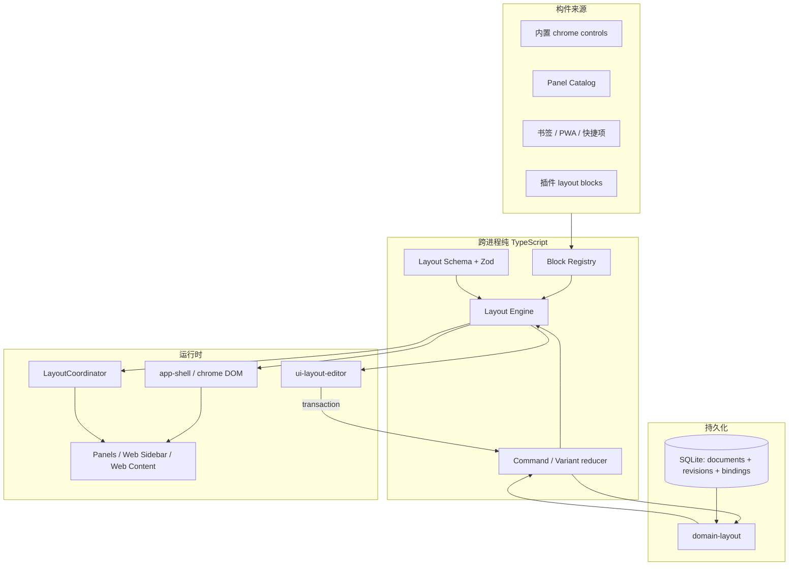
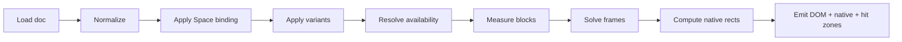

# 02 · 积木布局架构与数据契约

## 1. 一句话架构

**LayoutDocument 是唯一用户布局资产；BlockRegistry 提供可放置构件；LayoutEngine 把文档解释成 DOM 计划与原生视图几何；EditorSession 只通过命令修改文档。**



## 2. 核心概念

| 概念 | 定义 | 不负责什么 |
| --- | --- | --- |
| `LayoutDocument` | 一套可命名、可版本化、可导出的布局 | 不存标签内容、网页 URL、面板业务数据 |
| `LayoutNode` | 文档树中的 frame、block、spacer、divider | 不直接是 DOM；节点 id 稳定 |
| `LayoutFrame` | row / column / stack / tabs 等容器 | 不决定具体控件内部交互 |
| `LayoutBlock` | 一个控件、工具、应用、面板或内容槽 | 不认识编辑器、不做持久化 |
| `BlockDefinition` | 运行的 block 描述与能力约束 | 不携带不可序列化函数过 IPC |
| `LayoutVariant` | 对基础文档的一组受限 patch | 不创建第二份完整布局 |
| `ResolvedLayout` | 输入文档、视口、Space、模式、尺寸后的结果 | 不反向修改文档 |
| `LayoutEditorSession` | 编辑 draft、选择、drop、undo、保存的会话层 | 不直接改生产布局 DOM |

### 2.1 持久化状态与运行期状态必须分开

持久化：

- 栏位是否存在，节点顺序与父子关系；
- block 是否固定、是否允许隐藏 / 关闭；
- 默认宽度、最小宽度、占比、折叠策略；
- 面板组成员、标签组顺序、默认激活面板；
- Space / 窗口断点 / 专注 / 分屏等变体；
- 模板来源与 schema 版本。

不进入 LayoutDocument：

- 当前标签、当前 URL、滚动位置；
- 面板内部列表状态；
- hover 是否正在展开；
- 编辑器当前选中项；
- 临时拖拽 ghost；
- 网页侧栏当前网页内容本身。

面板“是否在屏幕上”可以作为会话恢复数据，但**面板组的结构**属于布局文档。

## 3. 文档模型

### 3.1 TypeScript 契约

> 新代码使用 TypeScript。纯模型与求解器放在无 Electron、无 DOM 的共享包里，主进程与 renderer 复用同一份。

```ts
export type LayoutAxis = 'row' | 'column'
export type NodeVisibility = 'always' | 'auto-hide' | 'collapsed' | 'hidden'
export type FrameMode = 'flow' | 'wrap' | 'scroll' | 'stack' | 'tabs' | 'overlay'

export interface LayoutDocument {
  schemaVersion: 1
  id: string
  name: string
  root: LayoutNode
  variants: LayoutVariant[]
  metadata: {
    createdAt: number
    updatedAt: number
    templateId?: string
    description?: string
  }
}

export type LayoutNode = LayoutFrame | LayoutBlockNode | LayoutSpacer

export interface LayoutFrame {
  type: 'frame'
  id: string
  role: 'root' | 'bar' | 'dock' | 'column' | 'panel-group' | 'toolbar-group' | 'tray'
  axis: LayoutAxis
  mode: FrameMode
  children: LayoutNode[]
  sizing: NodeSizing
  gap?: number
  padding?: BoxSpacing
  align?: 'start' | 'center' | 'end' | 'stretch'
  overflow?: 'grow' | 'scroll' | 'wrap' | 'drawer' | 'hide'
  collapse?: CollapsePolicy
  locked?: boolean
}

export interface LayoutBlockNode {
  type: 'block'
  id: string
  blockId: string
  children?: LayoutNode[]
  sizing?: Partial<NodeSizing>
  visibility?: NodeVisibility
  anchor?: 'start' | 'center' | 'end'
  locked?: boolean
  props?: Record<string, unknown>
}

export interface LayoutSpacer {
  type: 'spacer' | 'divider'
  id: string
  axis?: LayoutAxis
  sizing?: Partial<NodeSizing>
}

export interface NodeSizing {
  basis: number
  unit: 'px' | 'fraction' | 'content'
  min?: number
  max?: number
  grow?: number
  shrink?: number
}

export interface CollapsePolicy {
  enabled: boolean
  default: 'expanded' | 'collapsed' | 'hidden'
  mode: 'off-canvas' | 'icon-strip' | 'accordion' | 'peek'
  trigger: 'manual' | 'edge-hover' | 'focus-mode' | 'width'
  restoreWidth?: number
}
```

### 3.2 文档树约束

求解前必须做结构归一化：

1. 根节点只能是 frame。
2. 必须恰好存在一个 `content.main` block。
3. `single` 的 block 只能出现一次；`unique-per-parent` 按定义检查。
4. 子节点数量、允许父容器、允许轴、允许模式必须满足 `BlockDefinition.constraints`。
5. 未知 `blockId` 不删除。运行时标记为 dormant，编辑器中显示“来源不可用”。
6. 遇到坏数据时尽可能修复；无法修复再回退上一份 revision。
7. 所有数值夹到 block 的 min / max 与当前 viewport。
8. 变体只能应用受限 patch，不允许绕过上述约束。

### 3.3 Block Definition

```ts
export type BlockRuntimeHost = 'chrome-dom' | 'panel-native' | 'web-native' | 'overlay-native'

export interface BlockDefinition {
  id: string
  version: number
  title: string
  description: string
  family: 'bars' | 'controls' | 'apps' | 'panels' | 'bookmarks' | 'layout' | 'content'
  icon: string
  preview?: BlockPreview
  runtimeHost: BlockRuntimeHost
  cardinality: 'single' | 'multiple' | 'unique-per-parent'
  allowedParents: string[]
  allowedModes: FrameMode[]
  defaultSizing: NodeSizing
  constraints: {
    min?: { width?: number; height?: number }
    max?: { width?: number; height?: number }
    hideable?: boolean
    removable?: boolean
    collapsible?: boolean
    duplicable?: boolean
  }
  accepts?: string[]
  commands?: string[]
  inspector?: InspectorField[]
  capabilities: BlockCapability[]
}
```

这张定义表是 BlockRegistry 的公共契约。内置 block 和插件 block 走同一条注册路径。

## 4. 构件分层

### 4.1 内置 block 适配器

| Registry 来源 | 产出 block |
| --- | --- |
| 现有 navbar 目录 | Back、Forward、Reload、Home、Site Info、Bookmark、Extensions、Menu 等 |
| `PanelCatalog` | 每个 panel entry 自动成为一个 panel block，不再手工复制 |
| Tabbar | tab strip、新建标签、标签组、Space switcher、窗口控制（自绘时） |
| Bookmark / PWA | 固定书签、PWA app、站点快捷项 |
| 布局基础件 | bar、custom column、spacer、divider、panel group、toolbar group |
| Web Sidebar | remote page dock block |
| Content | 主网页内容槽 |

### 4.2 四种运行时宿主

| runtimeHost | 绘制方式 | 编辑器处理 |
| --- | --- | --- |
| `chrome-dom` | 外壳里的普通 DOM | 克隆真实控件，沿用现有几何上报 |
| `panel-native` | 独立面板 `WebContentsView` | 以面板头 / 边框的克隆矩形做拖放，提交后才改真实 bounds |
| `web-native` | Web Sidebar / 主内容视图 | 只做区域和边框预览；涉及网页覆盖时由原生 editor overlay 绘制 |
| `overlay-native` | 命令面板、快捷菜单、自定义浮层 | 先支持 placement descriptor，之后开放 anchor 编辑 |

### 4.3 Block 能力

能力不是散落 if，而是声明：

```ts
type BlockCapability =
  | 'editable-props'
  | 'drag-handle'
  | 'overflowable'
  | 'collapsible'
  | 'pinnable'
  | 'duplicable'
  | 'groupable'
  | 'contextual-visibility'
  | 'runtime-measure'
```

编辑器只读 `capabilities` 决定手柄、菜单和 inspector 是否出现。

## 5. 变体与上下文

### 5.1 一个基础布局，多个受控变体

```ts
export interface LayoutVariant {
  id: string
  label: string
  when: {
    minWidth?: number
    maxWidth?: number
    minHeight?: number
    maxHeight?: number
    context?: Array<'normal' | 'focus' | 'split' | 'immersive' | 'fullscreen'>
  }
  patches: LayoutPatch[]
}

type LayoutPatch =
  | { op: 'set-sizing'; nodeId: string; value: Partial<NodeSizing> }
  | { op: 'set-visibility'; nodeId: string; value: NodeVisibility }
  | { op: 'set-collapse'; nodeId: string; value: Partial<CollapsePolicy> }
  | { op: 'set-frame-mode'; nodeId: string; value: FrameMode }
  | { op: 'set-props'; nodeId: string; value: Record<string, unknown> }
```

变体禁止：

- 删除 `content.main`；
- 改变 block 的 `blockId`；
- 把 block 放进不允许的父容器；
- 嵌套应用另一个变体；
- 在 renderer 中执行任意脚本。

### 5.2 解析优先级

```text
安装默认
  < 当前 Profile 的基础 LayoutDocument
  < 当前 Space 绑定文档
  < 宽高匹配变体
  < 运行上下文变体（focus / split / immersive）
  < 用户本次会话的临时展开/折叠状态
```

“用户临时展开”只覆盖视觉宽度与显隐，不回写文档。关闭应用或离开 Space 后按文档默认值恢复。

### 5.3 特殊模式

| 模式 | 默认行为 | 是否可从编辑器配置 |
| --- | --- | --- |
| 普通 | 使用基础文档 | 是 |
| 窄窗口 | 匹配宽度变体 | 是 |
| 专注模式 | 自动隐藏非必需栏、面板与 app 坞 | 是 |
| 分屏 | 主内容切分，chrome 布局可保持或套用 split 变体 | 是 |
| 沉浸 / 全屏 | chrome 集体收起，边缘唤出 | 是 |
| Edge 型悬停侧栏 | 图标条常驻，展开为原生覆盖浮层 | 是 |
| 全功能型悬停侧栏 | 静止为零宽，贴边展开并推挤网页 | 是 |

这些模式统一进入 `LayoutEnvironment.context`，不在每个组件里读多个设置键自行判断。

## 6. LayoutEngine

### 6.1 输入

```ts
interface LayoutEnvironment {
  viewport: { width: number; height: number }
  dpr: number
  spaceId: string
  context: LayoutContext
  reducedMotion: boolean
  metrics: SurfaceMetrics
  blockAvailability: ReadonlySet<string>
}
```

`SurfaceMetrics` 仅包含无法脱离 DOM 得到的真实事实，例如某个 bar 的实测高度、字体行高、当前侧栏内容宽度。尺寸算术本身不在这里。

### 6.2 输出

```ts
interface ResolvedLayout {
  revision: string
  nodes: Record<string, ResolvedNode>
  chrome: ResolvedChromePlan
  native: {
    content: Rect
    panels: Array<{ instanceId: string; rect: Rect }>
    webSidebar: Rect | null
  }
  hitZones: DropZone[]
  warnings: LayoutWarning[]
}
```

### 6.3 求解流程



硬规则：

1. 未知 block 不参与尺寸计算，但不能被删除。
2. required block 缺失时，求解器回填安全默认节点并给出 warning。
3. 所有溢出都必须在最近的可收缩 / 可滚动 / 可抽屉祖先收口。
4. 不允许一个原生视图矩形覆盖另一个原生视图矩形。
5. `content.main` 必须获得最终剩余矩形。
6. DOM chrome 和 native rect 必须引用同一个 frame 求解结果。

## 7. 包与依赖边界

```text
packages/
  layout-model/
    src/
      schema.ts          Zod schema + normalized DTO
      definitions.ts     BlockDefinition / capability types
      commands.ts        pure command reducer
      variants.ts        restricted patch resolver
      index.ts

  layout-engine/
    src/
      solve.ts           pure frame solver
      geometry.ts        DOM / native output
      drop.ts            insertion, reparent, invalid reason
      preview.ts         template thumbnail geometry
      index.ts

domain/
  domain-layout/
    src/
      index.ts           service facade
      repository.ts      storage port
      migrations.ts      legacy settings -> LayoutDocument
      revisions.ts       undo / restore metadata

ui/
  ui-layout-editor/
    src/
      index.ts           dumb editor shell
      palette.ts
      canvas.ts
      inspector.ts
      minimap.ts
      drag-session.ts
      preview.ts
      tokens.css

apps/app-main/src/
  main/layout/
    block-registry.ts    adapters from chrome / panel / app catalogs
    layout-runtime.ts    applies ResolvedLayout
    ipc-layout.ts        typed IPC
  renderer/layout-editor/
    main.ts
    surface-adapters.ts
    index.html
```

依赖方向：

```text
layout-model <- layout-engine <- domain-layout
                         ^
                         |
ui-layout-editor <- apps/app-main
```

`ui-layout-editor` 不 import `domain-layout` 之外的应用客户端，也不直接调用 Electron IPC；通过注入的 `LayoutEditorPort` 取快照、发命令、查询 catalog。

## 8. 命令系统

编辑器只发出命令，不直接拼文档：

```ts
type LayoutCommand =
  | { type: 'insert'; parentId: string; index: number; node: LayoutNode }
  | { type: 'remove'; nodeId: string }
  | { type: 'move'; nodeId: string; parentId: string; index: number }
  | { type: 'reorder'; parentId: string; orderedIds: string[] }
  | { type: 'resize'; nodeId: string; sizing: Partial<NodeSizing> }
  | { type: 'set-props'; nodeId: string; patch: Record<string, unknown> }
  | { type: 'set-visibility'; nodeId: string; visibility: NodeVisibility }
  | { type: 'set-collapse'; nodeId: string; value: Partial<CollapsePolicy> }
  | { type: 'group'; nodeIds: string[]; frame: LayoutFrame }
  | { type: 'ungroup'; frameId: string }
  | { type: 'duplicate'; nodeId: string }
  | { type: 'rename-document'; name: string }
```

每次命令：

1. 通过 Zod 校验；
2. 在 draft 上归约；
3. 求解一次；
4. 更新 editor 视图；
5. 松手 / 停止输入后写入 revision；
6. 产生一条短语义 label，供 Undo。

Undo / Redo 使用命令前后快照或 patch；首版优先采用完整文档快照，文档体积小且实现更稳。连续拖动只入栈一次。

## 9. 数据持久化

### 9.1 为什么不再全塞 settings.json

现有 `domain-settings` 是低频键值配置，适合布尔值、字符串和小集合。布局文档具有：

- 结构嵌套；
- 二进制级 revision 增长；
- 模板、Space、导入导出；
- 需要事务和一致性；
- 可能由插件新增 schema。

继续塞进一条 JSON 字符串会让迁移、diff、恢复和并发都变得脆弱。使用 SQLite。

### 9.2 表结构

```sql
CREATE TABLE IF NOT EXISTS layout_documents (
  id TEXT PRIMARY KEY,
  profile_id TEXT NOT NULL,
  space_id TEXT,
  name TEXT NOT NULL,
  kind TEXT NOT NULL DEFAULT 'custom', -- custom | template | imported
  schema_version INTEGER NOT NULL,
  revision INTEGER NOT NULL DEFAULT 1,
  document_json TEXT NOT NULL,
  created_at INTEGER NOT NULL,
  updated_at INTEGER NOT NULL
);

CREATE TABLE IF NOT EXISTS layout_revisions (
  id INTEGER PRIMARY KEY AUTOINCREMENT,
  layout_id TEXT NOT NULL,
  revision INTEGER NOT NULL,
  action TEXT NOT NULL,
  document_json TEXT NOT NULL,
  created_at INTEGER NOT NULL,
  UNIQUE(layout_id, revision)
);

CREATE TABLE IF NOT EXISTS layout_bindings (
  profile_id TEXT NOT NULL,
  space_id TEXT,
  context TEXT NOT NULL DEFAULT 'default',
  layout_id TEXT NOT NULL,
  PRIMARY KEY(profile_id, space_id, context)
);

CREATE INDEX IF NOT EXISTS idx_layout_docs_scope
  ON layout_documents(profile_id, space_id, kind, updated_at);

CREATE INDEX IF NOT EXISTS idx_layout_revisions_doc
  ON layout_revisions(layout_id, revision DESC);
```

约束：

- `profile_id` 与现有 Profile 物理库一致。
- `space_id = NULL` 表示 profile 级布局；有值表示 Space 专有布局。
- 同一 Scope 的基础布局和变体都在同一个文档内，不另开 `variants` 表。
- revision 保留策略：最近 100 条或 30 天，二者取更宽；发布模板不自动删。

### 9.3 写入策略

- 拖动期间：只在 renderer 本地更新，不写库。
- drop / inspector 调整：生成命令，更新 draft，即时预览。
- 160ms trailing debounce 写库；关闭 Studio、切 Profile、退出时强制 flush。
- 写库用事务同时更新 `layout_documents.revision` 与 `layout_revisions`。
- 冲突用 `baseRevision` 乐观锁；不允许静默覆盖。

### 9.4 导入导出

文件格式：

```json
{
  "format": "hira-layout",
  "formatVersion": 1,
  "name": "Focus + Research",
  "document": {
    "schemaVersion": 1,
    "id": "imported-...",
    "root": {},
    "variants": []
  }
}
```

- 导入时重新生成本地 id，不信任文件内 id。
- 未知 block 保留为 dormant。
- 未知 inspector 字段保留，不执行。
- 任何导出都不包含网页 URL、cookie、历史、Space 私密笔记。

## 10. IPC 契约

粗粒度、命令式接口：

```text
layout:snapshot       { scope }                 -> { document, revision, catalog, metrics }
layout:dispatch       { layoutId, baseRevision, command }
layout:apply-template { scope, templateId }
layout:set-binding    { scope, layoutId }
layout:list           { profileId, spaceId }    -> metadata[]
layout:restore        { layoutId, revision }
layout:import         { text }
layout:export         { layoutId }              -> text
layout:changed        event                     { layoutId, revision, origin }
```

所有请求与响应必须有 Zod schema。

`layout:snapshot` 返回的 catalog 只含纯描述符。插件的预览 renderer 由 renderer-side slot 按稳定 key 提供，不把 DOM / 函数放上 IPC。

## 11. 插件扩展

新增官方扩展点建议：

| 扩展点 | 模式 | 产出 |
| --- | --- | --- |
| `layout.block-provider` | MULTI | 动态 block 描述符（如订阅源、快捷命令） |
| `layout.block-decorator` | REDUCE | 修改 block 标题、图标、能力，不改宿主业务 |
| `layout.template-provider` | MULTI | 声明式模板快照或模板来源 |
| `layout.inspector-fields` | REDUCE | 给某个 block 追加受支持字段描述 |
| `layout.variant-provider` | MULTI | 追加候选上下文，不直接写文档 |
| `layout.editor-action` | MULTI | 向选中节点菜单增加命令 |

渲染侧补充：

- `layout.block-renderer`：插件自绘自己的 chrome DOM block；
- `layout.block-preview`：目录卡 / 模板预览；
- `layout.template-renderer`：只能返回布局 mini-map 元素。

面板插件无需额外声明 block：`PanelCatalog` 适配器自动把每条 panel entry 变成 `panel:<id>` block。这样面板仍是唯一业务形状。

## 12. 旧数据迁移

### 12.1 迁移原则

- 只在首次升级运行一次。
- 迁移前将旧设置键整体复制到备份键。
- 失败时保留旧键并继续走 legacy runtime。
- 成功后将旧键标为 frozen，不再双写。
- 当前按钮顺序、隐藏项、抽屉归类、各块位置、面板宽度和 Web Sidebar 位置必须保真。

### 12.2 映射表

| 旧 key / 来源 | 新文档落点 |
| --- | --- |
| `app.navbar_buttons` | navbar block 的 `children` 顺序；hidden 项不生成 active node |
| `app.rail_buttons` | rail frame 的 `children`；drawer 数组进入 tray frame |
| `app.layout_preset` | 仅用于生成模板名，不进入长期真源 |
| `app.layout_mode` | root 或对应 bar 的 `mode` |
| `app.<bar>_position` | block 所在的 top / bottom / side frame |
| `app.chrome_row_order` | 行 frame 的 children 顺序 |
| `app.side_row_order` | 侧栏 frame 的 children 顺序 |
| `app.titlebar_enabled` | titlebar block 是否存在 |
| `app.window_controls_host` | 自绘 controls block 的父容器 |
| `app.window_controls_style` | 保持系统设置；native 时控件块不可移动 |
| `app.sidebar_position` | rail dock 的 edge |
| `app.rail_horizontal_align` / `vertical_align` | rail frame 的 align |
| `app.side_column_position` / `visibility` / `width` / `collapsed` | side column frame 的 edge、collapse、sizing |
| `app.panel_width_left/right` / `panel_pinned_width_*` | 对应 panel block 的 normal / pinned sizing |
| `app.web_sidebar_position` / `width` | Web Sidebar block 的 edge / sizing |
| 当前 tabbar / navbar side 组合 | classic / vertical-tabs / all-in-one 模板 seed |

### 12.3 迁移后的兼容层

第一阶段保留 `planChromeLayout` 作为 compatibility adapter：

- 新文档转换为 legacy plan 再喂给现有 `ui-chrome-layout`；
- 现有 `LayoutCoordinator` 继续使用旧参数；
- 新编辑器先对现有行为做等价编辑。

后续再把 `LayoutCoordinator` 切到 `ResolvedLayout.native`，避免第一天同时改编辑器、求解器和原生几何。

## 13. 失败与恢复

### 13.1 文档损坏

1. 尝试 schema 修复；
2. 回退最近一份有效 revision；
3. 再失败则加载 Safe Layout 文档；
4. 保留损坏原文，可在诊断页导出。

### 13.2 构件消失

- 插件被禁用：节点变成 dormant，不在生产界面渲染，但在编辑器中显示来源与恢复路径。
- 插件重新启用：节点恢复原父容器、顺序、尺寸和 props。
- 面板条目改名或图标变化：blockId 不变则位置不动。

### 13.3 用户把自己锁死

- 应用菜单、命令面板和 `Ctrl/Cmd+Shift+L` 始终可以进入 Studio。
- `Safe Layout` 只保留 content、tab strip、一个可见工具入口和恢复按钮。
- 启动时按住 Shift 进入 Safe Layout。
- 原生 WCO 按钮不可被应用布局删除；自绘按钮至少保留一个可恢复入口。

## 14. 性能约束

- 上位规范：[PART19 · 性能标准与优化手册](../../docs-new/11-性能标准与优化手册.md)；本系统的具体预算、缓存和净账见 [05-性能预算与优化台账](./05-性能预算与优化台账.md)。
- 求解复杂度目标：常见布局 `O(n)`，进入编辑器单次小于一帧预算。
- 拖动 ghost 只写 `transform` / `opacity`，不写 `left/top/width/height`。
- 每帧最多一次 drop 命中与一次插入线定位。
- 不进编辑模式时不创建 editor overlay renderer。
- block preview 按需生成；模板缩略图使用 SVG / DOM 结构，不缓存放大的位图。
- 面板原生视图只在提交时刻移动；拖动期间移动的是 overlay 中的 clone。
- 多面板组加载遵循现有“面板关闭即销毁”原则；编辑器不能为了预览而提前启动所有面板。
- 所有 hover / collapse / reveal 遵循 reduced-motion。
- 禁止在拖拽帧中调用 `getBoundingClientRect()` 扫描整棵树；启动拖拽时缓存几何，提交后重新测一次。
- 编辑器关闭后销毁 overlay renderer，并清空 resolution / preview / drag geometry 缓存；不留下后台 rAF、Timer 或订阅。
- 原生视图应用使用同一提交事务：可见性与 bounds 同帧、只写变化项、禁止重复 `addChildView`。
- 文档与 catalog 分开传输；单条 IPC ≤ 64KB，超出走分片，不把整份 catalog 随文档重复发送。

