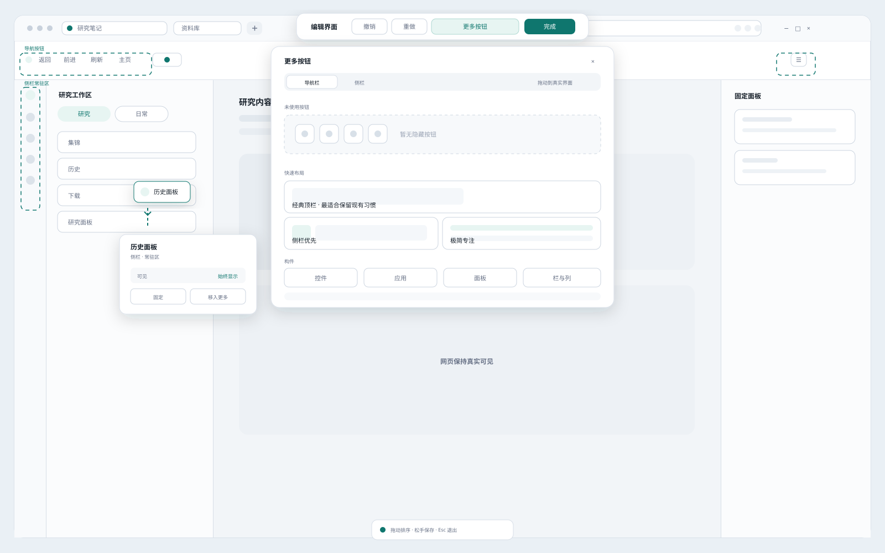

# 03 · 叠加式编辑交互与视觉规范



> 核心原则：**浏览器界面始终是主体，编辑能力以叠加层出现。**
> 不允许把浏览器整块替换成后台式编辑器；不遮挡不必要的网页、地址栏、标签和面板。

## 1. 产品形态

编辑模式由一个覆盖整窗的原生浮层承载，但视觉上透明：

- 真实 navbar / tabbar / rail / 面板 / 网页继续显示；
- 可编辑控件在相同坐标上生成克隆层，负责命中、拖拽与落位反馈；
- 顶部中央出现紧凑编辑工具条；
- “更多按钮”与构件库从顶部中央工具条下方展开；
- 选中构件后，仅在构件附近弹出轻量检查器；
- 模板和响应预览以居中浮层出现，不替换整页；
- 空白区域不铺蒙层、不改变浏览器视觉层级。

```text
┌──────────────────────── 真实浏览器界面 ────────────────────────┐
│                    [编辑界面 撤销 重做 完成]                    │
│                         [更多按钮]                              │
│  ┌ 地址栏 / 标签栏 / 当前网页 / 面板 ─────────────────────┐     │
│  │  ┏━━━━━━┓      真实内容保持可见        ┏━━━━━━┓        │     │
│  │  ┃按钮包┃                              ┃按钮包┃        │     │
│  │  ┗━━━━━━┛                              ┗━━━━━━┛        │     │
│  └────────────────────────────────────────────────────────┘     │
└──────────────────────────────────────────────────────────────────┘
```

叠加层只负责三件事：

1. 在真实控件坐标上绘制可编辑克隆；
2. 显示此刻可投放的区域、插入线和结构轮廓；
3. 提供局部工具面板。

它不绘制一个“假浏览器”，也不把普通用户丢进全屏后台界面。

## 2. 两个进入层级

### 2.1 直接编辑（默认）

打开后立即处于真实界面：

- 顶部中央小工具条：`编辑界面 · 撤销 · 重做 · 更多按钮 · 完成`；
- 可编辑按钮获得 1px 轮廓和拖拽能力；
- 栏位只在悬停、拖动或需要说明时显示虚线边界；
- 空白区域保持真实浏览器界面；
- 点击空白不会打开大面板，只清除选择。

直接编辑适合：

- 调换按钮；
- 隐藏或恢复按钮；
- 在 rail 的常驻区与抽屉区之间移动；
- 折叠 / 展开栏位；
- 把应用或面板拖到另一侧；
- 微调栏宽。

### 2.2 精修模式（同一叠加层）

点击中央工具条的「更多按钮」后，打开居中的局部面板：

- 宽度约 620px；
- 高度按内容增长，最大不超过视口减 120px；
- 位置固定在顶部中央工具条下方；
- 面板外侧仍有真实浏览器界面可见；
- 点击面板外任意位置即关闭；
- 结构画布、模板、构件库与检查器都在这个中央面板中切换。

精修模式不是另一个产品形态。它与直接编辑共享：

- 同一布局文档；
- 同一撤销栈；
- 同一选中节点；
- 同一尺寸和位置数据；
- 同一提交事务。

### 2.3 不允许的形态

- 打开编辑后整窗变成白色设置页；
- 构件库永久占据左侧一整列；
- 检查器永久占据右侧一整列；
- 用全屏深色蒙层压暗全部网页；
- 用固定三等分卡片铺满编辑界面；
- 把真实导航栏替换成一张仅供编辑的假导航栏。

## 3. 中央编辑工具条

### 3.1 常驻结构

```text
[ 编辑界面 ]  [ 撤销 ] [ 重做 ]  [ 更多按钮 ]  [ 完成 ]
```

必须有：

- 拖动窗口时不被误触（`no-drag`）；
- 水平居中；
- 窄窗口下自动缩短文案；
- 不覆盖地址栏主要输入区域；
- `Esc` 与「完成」等价；
- 布局脏状态显示小圆点；
- 保存失败时在当前工具条内呈现，不另开全屏错误页。

### 3.2 更多按钮

「更多按钮」始终位于中央工具条内。点击后：

- 面板在同一水平中线上展开；
- 面板不再贴右侧；
- 面板顶部保留当前栏位切换：导航栏 / 侧栏；
- 隐藏按钮池位于第一屏；
- 模板与构件库按分区向下排列；
- 抽屉关闭时保留用户上次所在分区。

面板顶部固定四个主分区：

```text
Templates  预设整套布局
Bars       标签栏 / 搜索栏 / 书签栏 / 应用坞 / 自定义栏
Controls   导航、搜索、窗口、工具、Space 等真实比例控件
Apps       当前 Space 的应用、面板入口与书签收藏
```

这些分区共用同一个中央面板，不分别打开多套全屏页面。

### 3.3 动效

- 打开 / 关闭中央面板：160–180ms，`ease-out`；
- 仅改变 `opacity` 与 `transform: translateY(-4px)`；
- 不使用全窗缩放；
- 真实浏览器 chrome 不参与位移动画。

## 4. 叠加层的几何来源

### 4.1 三层

| 层 | 内容 | 指针 |
| --- | --- | --- |
| 真实界面层 | 标签、地址栏、rail、面板、网页 | 编辑模式期间由原生叠加层接管 |
| 克隆交互层 | 实际坐标上的按钮、栏、面板头、应用图标 | 可点、可拖 |
| 工具层 | 中央工具条、更多按钮面板、检查器、状态条 | 局部可交互 |

### 4.2 坐标

- 每个 surface 上报自身视图坐标：
  - navbar；
  - rail；
  - 可选：panel header / web-sidebar header / bookmarkbar。
- 主进程补上视图偏移，统一转为窗口内容区坐标；
- 叠加层按同一坐标绘制克隆；
- 不允许渲染层自己猜 rail 宽度、面板偏移或标签栏高度。

### 4.3 重测

每次结构调整后：

1. 先提交本地模型；
2. 真实 surface 在下一帧应用；
3. surface 发回新几何；
4. 克隆层一次性更新；
5. 更新期间保持旧 clone 不闪烁。

## 5. 界面区域可视化

### 5.1 静止态

- 可编辑按钮有极淡轮廓；
- 不可编辑按钮仍可见，但不出现拖拽光标；
- 区域边界默认透明；
- 鼠标悬停某栏位时，才显示轻量虚线区域标题。

### 5.2 拖动态

所有当前可接受该 block 的容器显示：

- 1px 虚线；
- 容器名；
- 可创建新列的边缘按钮：`在此新建列`；
- 可接受新栏位的边缘带；
- 不能接收的容器只显示中性边框，不显示大红色禁止块。

### 5.3 插入态

- row 内显示 2px 竖线；
- column 内显示 2px 横线；
- tabs 组显示标签排序缝；
- 空容器显示与最终尺寸一致的 ghost 槽；
- 新列预览使用真实宽高，不用固定卡片截图。

## 6. 直接拖动

### 6.1 手势阶段

```text
pointerdown
  → 缓存 zone 与按钮几何
pointermove
  → 只更新 ghost 坐标
rAF
  → 一次命中 + 一次插入线
pointerup
  → 一次命令 + 一次提交
```

### 6.2 从“更多按钮”拖回

- 隐藏池卡片跟手移动；
- 原按钮从池中变淡，松手后移除；
- 拖到导航栏或 rail 的可用区域即可添加；
- 跨栏拖动默认作废，并给出可读原因；
- rail 常驻区与抽屉区之间允许互相移动；
- 导航按钮与面板按钮保持各自物理区域，除非该按钮声明了跨区能力。
- 拖动时显示的是**与真实控件同尺寸、同形态的样例组件**，不是文字胶囊或小图标；
- 标签栏拖动整条标签栏样例，搜索栏拖动整条搜索栏样例，应用拖动真实尺寸的应用图标；
- 松手后样例落位并映射到真实控件，不能只留下一个“名称卡”。
- 已落位控件优先使用编辑会话缓存的低精度窗口截图裁切作为拖动预览；首次进入抓取一次，后续只在布局签名实际变化时刷新，普通的指针移动和重复拖动不重复截图。

### 6.3 Bars 的整栏语义

`Bars` 分类里的“栏位”不是一个按钮槽，也不是一个布局区域选择器，而是**整条浏览器栏**：

- 标签栏、书签栏、navbar、rail 都是完整仿真样例；
- 指针按下后拖动的是整条栏的 1:1 克隆，不拆成内部按钮，也不换成小图标；
- 落位后的真实坐标上也继续绘制完整栏样例，不能退化成 30×30 名称块；
- 空书签栏等会自隐身的 bar 在编辑模式中保留完整占位图形，仍可拖拽和排序；
- rail 也必须以完整 bar 图形覆盖真实 rail 区域，内部控件编辑仍由 `Controls` 承担；
- 落下后修改的是整栏位置与顺序，内部按钮继续由 `Controls` 管理；
- 顶部 / 底部是横向落位；左侧 / 右侧是纵向落位；
- 标签栏落左/右 = `tabbar_position = side` + 侧栏所在侧，即 Edge 型垂直标签；
- navbar 再落到同一侧 = `navbar_position = side`，由既有 `planChromeLayout` 推导为全功能侧栏；
- 默认始终是 `navbar`、`tabbar` 两条独立行/带；只有把其中一条拖到另一条上覆盖后松手，才显式进入紧凑单行，且两个 bar 仍是独立节点；
- rail 落四个方向 = `app.sidebar_position` 的 `left / right / top / bottom`；
- 书签栏不能进入侧栏，落左侧 / 右侧时明确拒绝并保留原位置；
- `app.chrome_row_order`、`app.side_row_order` 与各栏位置仍由同一次落位事务共同更新；
- tabbar 与 navbar 在数据层永久是两个独立 block；紧凑模式只改变共同承载行的呈现，不合并节点身份或顺序表。
- rail 固定书签使用独立 `rail-pins` surface，只把最终书签 id 顺序写回 `railPinnedReorder`；不得混入 `app.rail_buttons`，也不得用隐藏按钮池模拟取消固定。
- 窗口控制按钮完全遵循设置中的宿主与能力矩阵，不进入编辑器的可拖动目录，也不生成伪造落位框。
- navbar 内部的导航区 / 面板区等容器组提供宽松的整体落位范围，但容器本身不可拖动；只有组内按钮可以排序和换位。

拖动目标按真实四向坐标命中。编辑器不能因为 rail 视图或某个内部按钮先占了指针命中区，就把整栏投放误判到别的 surface。

### 6.4 选择与检查

- 单击 clone：选中；
- 选中的 clone 外层显示 2px 强调描边；
- 在 clone 附近弹出小检查器：
  - 名称；
  - 当前区域；
  - 固定 / 隐藏；
  - 折叠策略；
  - 尺寸；
  - 删除 / 恢复。
- 检查器最大宽度约 260px，不占满右侧；
- 点击外部关闭；
- 检查器与 clone 同时滚动 / 跟随布局重测。

## 7. 不从全屏画布开始，也能完整拼积木

### 7.1 从边缘新建栏位

拖动构件接近窗口上、下、左、右边缘时，显示一条临时投放带：

```text
顶部：在此新建栏
底部：在此新建栏
左侧：在此新建列
右侧：在此新建列
```

松手后：

1. 创建新的 `LayoutFrame`；
2. 插入目标 block；
3. 真实主进程重排，但不移动网页直到提交完成；
4. 新栏以实际尺寸显示在叠加层；
5. 一次 undo 可完整移除。

### 7.2 从更多按钮面板拖出构件

更多按钮面板中提供：

- 栏与列；
- 控件；
- 标签；
- 应用；
- 面板；
- 收藏；
- 内容；
- 模板。

拖动过程中，真实浏览器保持原样；只有投放带和 ghost 出现在叠加层。

### 7.3 在已有区域打组

- 选中一个构件后按 `Shift` 多选；
- 选择「组合」；
- 在选中构件附近弹出结构预览；
- 选择横向 / 纵向 / 标签式；
- 应用后真实界面一次性更新。

### 7.4 编辑嵌套内容

双击栏位或工具栏组：

- 进入该容器的内部编辑；
- 顶部中央面包屑更新：`编辑界面 / 导航栏 / 面板按钮`；
- `Esc` 逐级退出；
- 进入容器不会改变浏览器视觉边界，只加强对应区域的轮廓。

## 8. 自定义列

### 8.1 新增

用户在更多按钮面板中拖动「自定义列」到左/右边缘，或直接点边缘投放带里的 `+`。

新列具备：

- 位置：left / right；
- 轨道顺序；
- 宽度；
- 最小 / 最大宽度；
- 默认展开 / 收起；
- 常驻 / 自动隐藏；
- 列内轴：row / column；
- 是否显示列头；
- 允许的变体。

### 8.2 内容

列内可放：

- 面板组；
- 工具栏组；
- 固定书签；
- Space 切换；
- 命令；
- 间隔 / 分隔线；
- Web Sidebar；
- 插件 block。

### 8.3 操作

- 拖动列边缘改宽；
- 点击列头折叠；
- 拖动整个列头换边；
- 按住 `Alt` 拖动创建副本；
- 双击列头打开列属性；
- 删除列时先确认其中的面板是否保留到工具抽屉。

## 9. 面板组

### 9.1 在真实界面上操作

- 面板头是拖拽把手；
- 将两个面板头叠在一起 → 自动组成 tabs 组；
- 拖到面板组上下边缘 → 进入 stack；
- 拖到分组标签条 → 加入 tabs；
- 拖出 → 恢复独立面板；
- 固定按钮决定它是否保持在当前组。

### 9.2 组形态

| 形态 | 叠加层表现 |
| --- | --- |
| tabs | 只显示组头与激活面板，其他成员在标签列表 |
| stack | 每个成员保留独立头，按上下区域排列 |
| accordion | 组头列表 + 当前展开面 |
| floating | 原生浮层预览；关闭后回到原组 |

### 9.3 容量与生命周期

- 面板仍由现有 PanelCatalog 提供；
- 一个 panelId 全局只有一份 view；
- 布局只决定矩形、组关系、显隐；
- 关闭面板即销毁 renderer 的既有规则不变；
- 打开叠加编辑层不预热任何面板。

## 10. 收起、展开与特殊模式

### 10.1 栏位

- 手动折叠；
- icon-strip；
- off-canvas；
- 边缘唤出；
- 窄窗口自动折叠；
- 专注模式自动收起。

### 10.2 面板组

- 收起后保留组；
- 重新展开恢复上次宽度；
- 非激活成员不加载 renderer；
- 切换组内成员按需冷启动。

### 10.3 特殊模式

| 模式 | 可见行为 |
| --- | --- |
| 专注 | 非必需栏与 app 隐藏，保留快速恢复条 |
| 分屏 | 内容区切分，chrome 按 variant 决定是否收起 |
| 沉浸 | 窗口边缘唤出，叠加编辑仍可从中央工具条打开 |
| 窄窗口 | 响应变体生效，更多按钮面板宽度自适应 |
| 多窗口 | 叠加层只作用于当前窗口，几何与 Space 按窗口隔离 |

## 11. 模板

### 11.1 入口

模板位于中央「更多按钮」面板的「模板」分区，不再占用整屏。

### 11.2 内容

首版：

- 经典；
- 原味侧栏；
- 竖向导航；
- 研究方向；
- 极简专注；
- 底部应用坞；
- 空白布局。

### 11.3 预览

缩略图由布局求解器生成：

- 137×84px；
- 只画结构框、面板区、应用区；
- 选择模板后，真实浏览器界面直接进入草稿预览；
- 顶部中央工具条出现「应用 / 撤销」；
- 模板面板保持在上方，不需要切换到全屏预览。

## 12. 图文预览

### 12.1 构件卡

```text
[图标 / 结构略图]  名称
                    一句用途
                    来源 / 可用状态
```

尺寸紧凑，适合中央面板的双列 / 三列自适应网格，不做大图营销卡。

例外：`Bars`、`Controls` 与 `Apps` 中的**主要可拖样例**必须保持真实比例：

- Tab Bar 是一条完整横向轨道，包含窗口按钮、标签、关闭与新增等结构；
- Search Bar 包含站点图标、地址、收藏、刷新、扩展等真实尺寸控件；
- Bookmark Bar 使用真实书签宽度与间距；
- Spaces + Apps 使用真实图标尺寸与胶囊间距；
- Controls 使用真实按钮大小、图标和 label，而不是缩成 16px 的图标列表；
- 拖动开始时克隆该样例的当前完整外观，按 1:1 尺寸跟随指针；
- 只有目录中的次级分类标签可以使用小图标 / 文字。

### 12.2 实时预览

- 用户拖动时看到真实栏位；
- 选中构件时看到实际尺寸；
- 模板应用时真实浏览器界面是预览载体；
- 响应式预览以小型浮动窗口显示，不替换主窗口；
- 面板用头部、图标、色条和骨架展示，不截取真实面板内容。

### 12.3 MiniMap

- 位于检查器底部；
- 默认 220×120px；
- 只用于定位和导航，不是主编辑画布；
- 点击节点可在真实界面选中对应构件；
- 节点多时支持滚动，不缩成不可点击的小点。

## 13. 中央面板

### 13.1 排版

```text
┌──────────────── 更多按钮 ────────────────┐
│ 导航栏 | 侧栏                    关闭      │
├───────────────────────────────────────────┤
│ 未使用按钮  [图标] [图标] [图标] ...        │
│ 模板        [经典] [竖向] [研究] ...        │
│ 构件        [控件] [应用] [面板] [布局]     │
└───────────────────────────────────────────┘
```

- 位置：水平居中，工具条下方 8px；
- 宽度：620px 左右；
- 内容超过高度时内部滚动；
- 不覆盖整个网页；
- 点击外部或再次点「更多按钮」关闭；
- 拖拽过程中不自动关闭；
- 拖拽到面板外后，面板保持开启，方便连续添加。

### 13.2 状态

- 打开位置只在中央；
- 不记忆为右侧抽屉；
- 不同窗口各自记住中央面板的选中分类；
- 窗口过窄时改为 32px 边距的居中面板，不变成整宽页面。

## 14. 检查器

检查器改为上下文浮层：

- 选中按钮 / 栏位时出现在控件附近；
- 默认宽 250–280px；
- 可以选择固定到中央工具条下方的「更多按钮」面板；
- 关闭选择后消失；
- 不永久占走网页宽度；
- 小窗口只显示核心字段，其他字段滚动。

## 15. 响应式与窗口变化

- 窗口 resize 时，工具条保持水平中央；
- 更多按钮面板始终以视口中心为锚；
- 检查器优先出现在选中物下方；空间不足时上方；
- 不超出窗口安全区；
- 用户正在拖拽时 resize：取消当前拖动并保留原布局，避免坐标系漂移；
- 变体切换后，若选中节点变 hidden，选中态保留到父容器，并显示提示。

## 16. 视觉规范

### 16.1 材质

- 工具条与中央面板使用实色 elevated surface；
- 1px 边框；
- 浮层阴影仅表达悬浮关系；
- 不使用玻璃拟态、紫色渐变和全屏模糊。

### 16.2 色彩

- 强调色：主题 accent；
- 编辑器普通文字：primary / secondary；
- 选中：accent + accent-soft；
- 不可用：faint；
- 警告：warning；
- 非法操作：danger，但不整屏泛红。

### 16.3 形状

- 中央工具条：12–14px；
- 更多按钮面板：13–16px；
- 按钮 clone：与真实按钮同尺寸、同圆角、同图标；
- 区域边框：1px 虚线；
- 选中：2px；
- 插入线：2px。

### 16.4 间距

- 工具条到顶部：12–16px；
- 工具条到更多面板：8px；
- 面板内边距：12–16px；
- 分组间距：12–18px；
- 所有尺寸使用 4px 栅格。

## 17. 动效

| 动作 | 时长 | 变化 |
| --- | --- | --- |
| 工具条出现 | 160ms | opacity + 4px translateY |
| 更多面板 | 170ms | opacity + 轻微 translateY |
| 选中 | 100ms | 边框透明度 |
| 插入线 | 80ms | opacity |
| 新列预览 | 120ms | opacity |
| 关闭 | 120ms | opacity |

拖动中的 ghost 和插入线不走 transition。`prefers-reduced-motion` 下全部关闭。

## 18. 可访问性

- 全部操作有键盘替代；
- 拖动中的 ghost 不可聚焦；
- 真实控件在编辑模式中不可误触；
- 进入编辑后焦点落在中央工具条；
- `Tab` 只在编辑工具与克隆间移动；
- `Esc`：先取消拖动，再关闭更多面板 / 检查器，再退出编辑；
- 状态变化通过 `aria-live` 通知；
- 不使用颜色单独表达可用 / 不可用。

## 19. 错误和恢复

### 19.1 保存失败

- 中央工具条显示错误指示；
- 编辑草稿保持；
- 不关闭编辑器；
- 不覆盖最后一次成功 revision；
- 可重试。

### 19.2 构件不可用

- 当前界面中的节点显示虚线占位与来源；
- 用户可以选择移除或保留 dormant；
- 插件恢复后自动回位；
- 不允许静默删除。

### 19.3 用户隐藏所有入口

- 中央工具条只在编辑期间出现，但应用菜单、命令面板和快捷键始终可再次打开；
- `Safe Layout` 可从命令面板恢复；
- 关闭按钮位于中央工具条右侧。

## 20. 性能底线

完整标准见 [05-性能预算与优化台账](./05-性能预算与优化台账.md) 与 [PART19 性能手册](../../docs-new/11-性能标准与优化手册.md)。

- 编辑层背景透明，不额外渲染大画布；
- 只绘制当前可见控件的克隆；
- pointermove 只写 ghost transform；
- 每次 pointerup 只提交一个命令；
- 不在拖动中调整真实 `WebContentsView`；
- 关闭编辑器时销毁 overlay renderer 和全部临时节点；
- 工具条和更多面板不触发浏览器布局重排；
- 更多面板中的模板缩略图按需生成；
- 检查器每次只渲染当前选中节点；
- 中央面板关闭后不保留后台 DOM 或监听。

## 21. 验收清单

1. 打开编辑后，可以清楚看见并理解原浏览器界面。
2. 工具条在窗口顶部中央。
3. “更多按钮”按钮在中央工具条内。
4. 打开“更多按钮”后，其面板在窗口中央展开。
5. 隐藏按钮池、模板和构件分类都在中央面板中可用。
6. 从中央面板拖出按钮，能落到真实 navbar / rail 区域。
7. 隐藏按钮可从中央池恢复。
8. rail 常驻区与抽屉区可拖动互换。
9. 能拖动到窗口边缘新建栏或列。
10. 能在同侧创建第二个面板组。
11. 收起、展开、固定和删除都可撤销。
12. 面板错位、导航错位或选中物重叠都不允许出现。
13. 窗口变窄后中央面板仍居中，不变成全屏。
14. 关闭编辑后浏览器界面完全恢复，控件可正常点击。
15. 性能三个大里程碑各通过一次统一门禁，不做逐阶段重复检测。
