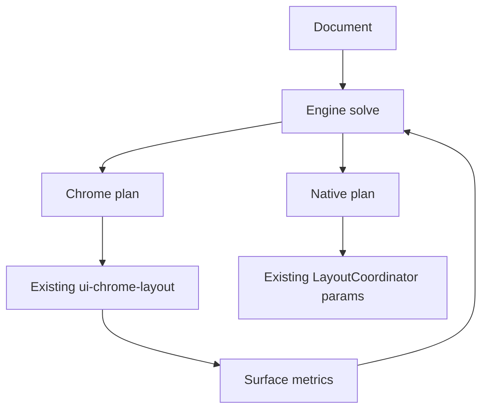

# 04 · 实施顺序与落地清单

> 本文不是要求按阶段停下来汇报。实施时应按顺序连续完成，只有出现必须由用户决定的真实产品冲突时才暂停。
>
> 性能门禁合并到三个大里程碑统一验收，不在每个小阶段重复跑完整检查：
> A–C 完成后、D–E 完成后、F–H 完成后各做一次。中间阶段只保证功能可继续推进。

## 1. 完成定义

一次完整重构结束时必须同时满足：

1. 用户能从菜单和快捷键直接进入浏览器界面叠加编辑，不出现全屏后台式编辑器。
2. navbar、tabbar、rail、bookmarkbar、titlebar 的现有按钮编辑能力全部由新文档驱动。
3. 用户能新增左右自定义列，并在列中放置面板、工具、应用、间隔和分隔线。
4. 用户能在同一侧建立多个面板组，并选择并排 / 标签 / 堆叠 / 折叠。
5. 用户能选择模板，或在空白布局上从构件库拼装。
6. 拖放、尺寸、收起、显隐、分组、撤销与重做完整可用。
7. 布局随 Profile、Space、窗口宽度和特殊模式正确解析。
8. 布局保存在 SQLite，可导入导出、恢复 revision、恢复默认。
9. 插件新增 / 禁用面板和 block 时，不破坏用户布局。
10. 所有关键几何仍以主进程 `WebContentsView` bounds 为准，网页、面板、侧栏不重叠。
11. 旧设置一次性迁移，迁移后无第二套布局真源。
12. 删除被替代的旧代码，不保留“为了保险”的平行状态。

## 2. 连续实施顺序

### 阶段 A · 契约与兼容层

目标：让新模型可运行，但暂不改变用户看到的界面。

交付：

- `packages/layout-model`
  - `LayoutDocument` / `LayoutNode` / `BlockDefinition` / `LayoutVariant`；
  - Zod schema；
  - command reducer；
  - 版本号与归一化。
- `packages/layout-engine`
  - frame 求解；
  - drop 命中；
  - chrome compatibility output；
  - native region output；
  - template minimap。
- `domain/domain-layout`
  - 服务门面；
  - repository port；
  - legacy migration；
  - revision 规则。
- 旧设置 → 文档导入器。
- 文档 → 旧 `planChromeLayout` 兼容适配器。

此阶段必须保持当前界面渲染结果。这里用兼容适配器不是为了长期双轨，而是把重构切成可控的连续两步。

### 阶段 B · 垂直切片

目标：先让现有的按钮排序 / 显隐在新编辑器里端到端跑通。

交付：

- 新 editor overlay 页面；
- 复用现有 `buttons-edit:set-active` 的覆盖层生命周期；
- navbar / rail 的 `SurfaceAdapter`；
- 构件库里的控件与面板；
- Quick Edit 的拖动、drop、按钮池；
- 命令式撤销重做；
- 现有 `app.navbar_buttons` / `app.rail_buttons` 的等价导入与写回兼容。

验收场景：

1. 把后退按钮从导航区拖到面板区：若能力矩阵不允许，明确拒绝。
2. 把历史面板从 rail 拖到抽屉：写入 draft，松手后即时更新。
3. 连续拖 10 次，只产生 10 个 undo 步骤。
4. 插件面板被禁用后，编辑器保留其占位并提示来源不可用。

### 阶段 C · 通用栏与响应变体

目标：让 chrome 块进入同一个文档模型。

交付：

- 将 tabbar / navbar / titlebar / bookmarkbar 转为 block；
- top / bottom / left / right 容器；
- row / column / wrap / overflow drawer；
- 柱宽与最小 / 最大约束；
- 宽度变体与 context variant；
- 用 LayoutEngine 生成现有 `ui-chrome-layout` 可消费计划；
- 旧 `app.*_position` / row order 写向文档。

首轮叠加编辑的整栏落位先与现有布局真源保持一一映射：

| 拖动对象 | 顶 / 底 | 左 / 右 |
| --- | --- | --- |
| tabbar | `app.tabbar_position = top / bottom` | `side` + `app.side_column_position` |
| navbar | `app.navbar_position = top / bottom` | `side` + 同一条侧栏位置 |
| titlebar | `app.titlebar_position` | `side` + 同一条侧栏位置 |
| bookmarkbar | `app.bookmarkbar_position` | 不支持；保持原横栏位置 |
| rail | `app.sidebar_position = top / bottom` | `app.sidebar_position = left / right` |

`Bars` 内的拖动单位始终是整条栏。内部控件仍由 `Controls` 编辑，两者不能混成同一类 primitive。

切换准则：

- 先用新文档驱动 `planChromeLayout` 等价输出；
- 手动交互与几何稳定后，再移除旧设置读写；
- 旧设置文件保留备份，不再双写。

### 阶段 D · 叠加编辑交互

目标：在真实浏览器界面上完成完整编辑体验，不替换浏览器主体。

交付：

- 顶部中央编辑工具条；
- 中央「更多按钮」面板，而不是永久左右栏；
- 模板 / 栏与列 / 控件 / 标签 / 应用 / 面板 / 收藏 / 内容分类；
- 结构性模板缩略图；
- 真实控件克隆与局部虚线投放区；
- 上下文检查器；
- 浮动响应预览 / MiniMap；
- 拖动构造新栏、新列、面板组；
- 非法 drop 原因；
- 在真实界面中 Live Preview；
- 保存 / 应用 / 恢复默认。

优先级：

1. 真实界面上的直接拖动与多区域 clone；
2. 中央工具条与居中更多按钮面板；
3. 撤销重做；
4. 边缘新建列 / 面板组；
5. 模板、缩略图与上下文检查器。

### 阶段 E · 自定义列与多面板

目标：实现“新加几栏固定其他面板、功能内容”。

交付：

- `custom-column` block；
- `panel-group` block；
- 同侧多面板组；
- tabs / stack / accordion；
- 每列独立宽度、折叠、常驻、浮层；
- 面板 pin；
- Web Sidebar 作为可组合 block；
- pane / group 的 focus、hover、activation 语义。

主进程改造重点：

- `_panelSlots` 的单槽模型升级为**布局结果驱动**；
- 保留 `panelId` 全局单实例；
- 每块面板仍只有一个 view；
- panel header actions 不变；
- 关闭后的 view 回收不变；
- 面板组只复用现有 view，不复制 DOM/渲染进程。

这里应避免修改 `PanelEntry` 去表达布局。面板只回答“我是谁、怎么加载”，布局文档回答“我在哪、和谁组成组”。

### 阶段 F · 持久化与产品化

目标：从编辑器原型变成可长期使用的用户资产。

交付：

- SQLite tables + migration；
- profile / space binding；
- 160ms 合并写入；
- revision 上限与恢复；
- Safe Layout；
- `.hira-layout.json` 导入导出；
- 用户模板；
- 首次使用引导；
- 上下文模式预览。

### 阶段 G · 插件接口

目标：后续新增功能不再修改编辑器核心。

交付：

- `layout.block-provider`；
- `layout.block-decorator`；
- `layout.template-provider`；
- `layout.inspector-fields`；
- `layout.variant-provider`；
- `layout.editor-action`；
- renderer slots：`layout.block-renderer` / `layout.block-preview`；
- 官方扩展点文档。

内置面板、书签、PWA、rail pins 先全部通过内部 adapter 注册，以证明插件与内置走同一条路。

### 阶段 H · 原生几何切换与清理

目标：彻底消除旧布局真源。

交付：

- `LayoutCoordinator` 接受 `ResolvedLayout.native`；
- 移除 renderer 侧“摆好后量高度再猜”的主要结构参数；
- 保留无法纯计算的字体 / 内容实测；
- 删除 legacy adapter；
- 删除 `app.*_buttons` 长期写路径；
- 删除旧 top/bottom/side 单侧栏限制；
- 删除纯单槽 panel placement；
- 删除被新命令系统替换的编辑逻辑；
- 更新文档、插件指南、功能点映射。

## 3. 包与文件清单

### 3.1 新建

```text
packages/layout-model/
packages/layout-engine/
domain/domain-layout/
ui/ui-layout-editor/

apps/app-main/src/main/layout/
  block-registry.ts
  layout-runtime.ts
  ipc-layout.ts
  legacy-migration.ts

apps/app-main/src/renderer/layout-editor/
  index.html
  main.ts
  surface-adapters.ts

apps/app-main/src/renderer/shared/layout-editor-client.ts
```

### 3.2 改造

| 文件 / 区域 | 改造 |
| --- | --- |
| `apps/app-main/src/renderer/app-shell/main.js` | 从新 BlockRegistry 装配 block；通过 LayoutEditorPort 提供几何；订阅 layout changed |
| `apps/app-main/src/renderer/controllers/chrome-layout-controller.js` | 最终由 LayoutEngine 的 chrome plan 替代分散布局设置 |
| `apps/app-main/src/renderer/controllers/window-layout-controller.js` | 精简为 surface metrics / reveal 状态上报 |
| `ui/ui-chrome-layout/src/index.js` | 支持任意 frame 层级；保留节点搬移不重建 |
| `ui/ui-navbar/src/toolbarRegistry.js` | 先保留为 navbar SurfaceAdapter，再迁入通用 block children |
| `ui/ui-navbar/src/toolbar/ledger.js` | 行为合并进 BlockRegistry / EditorSession 后删除 |
| `ui/ui-navbar/src/toolbar/zones.js` | 几何逻辑抽取为 SurfaceAdapter，再由 editor 使用 |
| `apps/app-main/src/renderer/rail/main.js` | rail 组件变为 block 宿主与 adapter |
| `apps/app-main/src/main/ipc/buttons-edit.js` | 被 `ipc-layout.ts` 的 editor session 通道替代 |
| `infra/infra-window/src/LayoutCoordinator.js` | panel slots 改为 resolved panel rects；增加多列 / 组 / web sidebar 结果 |
| `apps/app-main/src/main/panel-catalog.js` | 作为 registry adapter 来源，不再感知布局 |
| `apps/app-main/src/main/panel-presentation.js` | 保持单实例语义，接入组的隐藏 / 激活 |
| `packages/shared-types/src/layout.mjs` | 第一期为兼容输出；最终只保留主题 / 安全阈值等共享常量或迁入 layout-model |
| `infra/infra-db/src/schema.js` + DDL | 添加 layout documents / revisions / bindings |
| `infra/infra-ipc/src/contracts/` | 新增 layout-editor contracts |
| `infra/infra-plugin/src/official-extension-points.js` | 新增 layout 扩展点 |
| `docs-ng/插件化落地现状与扩展指南.md` | 记录新 block / template 插槽的实际宿主 |

### 3.3 删除 / 合并

以下内容在对应功能迁移完成后删除：

- `apps/app-main/src/renderer/buttons-edit-overlay/`（由 layout editor overlay 接替）；
- `ui/ui-navbar/src/toolbar/ledger.js`；
- `ui/ui-navbar/src/toolbar/zones.js`；
- `ui/ui-navbar/src/toolbarRegistry.js`；
- settings 中 navbar / rail 按钮长期读写分支；
- 旧的布局 preset 宏与 UI 分散读写路径；
- `LayoutCoordinator` 中单 panel slot / pinned slot 的固定双槽算术；
- 只为旧按钮编辑服务的 IPC；
- 旧文档中“新增按钮需要改 3 处”的说明。

删除前先确认用户数据已经迁移，且 legacy 键只作为备份存在。

## 4. 主进程接入草图

### 4.1 Snapshot

```ts
const snapshot = {
  scope: { profileId, spaceId, context: 'default' },
  revision: 12,
  document,
  catalog: blockRegistry.descriptors(),
  metrics: surfaceMetrics.snapshot(),
  templates: templateRegistry.listDescriptors()
}
```

### 4.2 Dispatch

```ts
const result = await layoutPort.dispatch({
  layoutId: snapshot.document.id,
  baseRevision: session.documentRevision,
  command
})

if (!result.ok) {
  session.rebase(result.document, result.revision)
  return
}

session.accept(result.document, result.revision)
runtime.apply(resolveLayout(result.document, environment))
```

### 4.3 Runtime

```ts
interface LayoutRuntime {
  apply(resolved: ResolvedLayout): void
  preview(draft: LayoutDocument): void
  clearPreview(): void
  measure(): SurfaceMetrics
}
```

`ui-layout-editor` 只认识这个端口，不认识 Electron、SQLite、PanelCatalog 或 vue/react。

## 5. 旧设置的迁移执行

1. 读取当前 profile 的 settings 快照；
2. 读取当前 Space scope；
3. 从当前 `planChromeLayout` 产物建立基础 frame；
4. 导入 navbar / rail 顺序与 hidden / drawer；
5. 生成 titlebar / bookmarkbar / panel slots；
6. 导入两侧面板宽度与 pinned 宽度；
7. 导入 Web Sidebar 位置 / 宽度；
8. 生成一个 `classic-v1` 文档和一个当前组合的 `migrated-current` 文档；
9. 写 binding；
10. 以真实运行结果与旧界面做几何对照；
11. 成功后冻结旧读写，保留备份键；
12. 失败则回到 legacy runtime，并在日志里输出具体字段。

迁移不能只做字段映射就结束，必须完成“打开后看起来一样、交互一样”的验证。

## 6. 几何接入顺序



第一阶段保持闭环：renderer 摆 DOM → 上报 metrics → engine 生成 native plan → LayoutCoordinator 应用。

第二阶段才允许：

- DOM 和 native 同时消费同一个 ResolvedLayout；
- 编辑器直接读取 `hitZones`；
- 拖拽使用同一份 geometry cache。

顺序不能反。否则会在布局模型尚未稳定时同时改原生几何。

## 7. 面板和 Web Sidebar 的特殊约束

### 7.1 DOM 不能画在网页之上

这是现有架构铁律。因此：

- editor overlay 是原生浮层；
- Live Preview 的说明层、落位框也必须由 overlay 画；
- chrome DOM 只出现在网页让出来的位置；
- 拖动中的面板预览不是真实面板内容，而是 head / outline / skeleton。

### 7.2 面板单实例

- `panelId` 全局只一个 view；
- panel group 只组织 view 的位置；
- 同一面板不能同时出现在左右两组；
- “复制”面板默认禁用，除非未来 PanelDefinition 明确声明 multi-instance 能力。

### 7.3 面板关闭即销毁

编辑器不得预加载所有面板来生成真实缩略图。使用 panel manifest 的 icon / title / color token + 结构化占位。

### 7.4 焦点

- 叠加编辑层打开时，编辑器 overlay 持按键焦点；真实页面不响应编辑快捷键；
- 退出后焦点回到活动网页或地址栏；
- 面板组激活面板遵循显式状态，不从 `blur` 派生。

## 8. 命令与撤销细节

- 一次完整 pointer drag = 一个 undo entry。
- 拖回原位 = 不写 revision，不产生空 undo。
- 调整尺寸的连续输入合并为一条。
- inspector 文本输入使用局部事务，失焦或回车提交。
- 模板应用是一条 undo entry。
- 导入布局是一条 undo entry。
- 切换绑定（Space A → 文档 B）不是布局修改，不进入文档 undo，但进入编辑器全局撤销。
- undo 后必须重新求解并本地预览；保存时机仍走 debounce。

## 9. 插件兼容策略

### 9.1 已有插件

- `contributes.panels` 自动映射，不需要迁移插件 manifest；
- `navbar.button-slot` / `side-panel.rail-icon-slot` 原有按钮继续映射为 action blocks；
- `layout.root-slot` 继续作为 chrome-level renderer slot 存在，但不绕过布局模型；
- 面板头部动作不进主导航 block，继续由面板宿主管理。

### 9.2 新增 layout 插件

最少只需声明：

```json
{
  "contributes": {
    "layoutBlocks": [
      {
        "id": "example.focus-timer",
        "title": "专注计时",
        "family": "apps",
        "runtimeHost": "chrome-dom",
        "allowedParents": ["bar", "column", "tray"],
        "defaultSizing": { "basis": 32, "unit": "px" }
      }
    ]
  }
}
```

渲染实现由 `.renderer.js` 的 slot 提供。主进程不允许把函数直接塞进文档。

## 10. Safe Layout

Safe Layout 文档最小结构：

```text
root(row)
  └─ column
      ├─ bar
      │   ├─ tab strip
      │   ├─ address bar
      │   └─ layout studio action
      └─ content.main
```

它的作用不是替代正常布局，而是：

- 启动恢复失败时仍可开浏览器；
- 用户误删不可恢复控件后可回到 Studio；
- 插件导致某个 layout block 崩坏时可诊断；
- 不依赖用户当前文档中是否存在任何入口。

恢复入口：

- 应用菜单；
- `Ctrl/Cmd + Shift + L`；
- `hira://layout`;
- 启动时按住 Shift；
- 现有命令面板增加 `打开布局工坊` / `恢复安全布局`。

## 11. 验收与验证口径

按用户偏好，不把测试作为阻塞主线的阶段。功能完成以实际启动、真实拖放和真实持久化为第一验收。只在以下节点做轻量证据检查：

1. 新纯引擎可被 main / renderer 同时 import；
2. 迁移前后同一布局的块位置、宽度与显隐一致；
3. 拖动中无主进程同步写盘；
4. 面板视图在拖动期间不被反复销毁 / 重建；
5. 页面、面板、Web Sidebar 的 bounds 无重叠；
6. 重启后布局恢复；
7. 撤销 / 重做跨多次拖放正确；
8. 插件禁用 / 恢复后位置不丢；
9. Safe Layout 可进入；
10. 构建输出无旧编辑器重复入口。

性能验收在以下三个里程碑统一执行，不逐阶段重复：

1. **P1（A–C 完成后）**：布局模型、迁移、基础 chrome 与原生 bounds 正确。
2. **P2（D–E 完成后）**：Studio 拖拽、多列、面板组的功能与帧预算。
3. **P3（F–H 完成后）**：持久化、插件、全量替换与最终内存 / 波及账。

每个里程碑统一检查：

- 输入到第一帧可见反馈 ≤ 16ms；
- 连续拖动帧间隔 P95 ≤ 20ms；
- 主进程同步块 ≤ 8ms，16ms 以上一票否决；
- 原生 bounds / visible / addChildView 只写变化项；
- 叠加编辑层打开不新增任何 panel renderer；
- 关闭 Studio 后无 rAF、Timer、订阅和 overlay renderer 残留；
- 空闲 5 分钟内存漂移 ≤ 5%。

## 12. 回滚

### 12.1 功能开关

保留两个短期开关：

- `layout.engine = legacy | v2`
- `layout.editor = buttons | studio`

功能开关不是为了永久双轨，而是让同一构建可以安全切换。稳定后删除。

### 12.2 数据回滚

- 新表独立，不修改旧 settings 值的语义；
- 迁移前备份旧 keys；
- 关闭 v2 后 legacy runtime 仍能读旧键；
- 导入失败不改当前 binding；
- revision restore 不删除更新版本，只创建新的恢复 revision。

## 13. 实施中必须守住的红线

- 不增加多个布局真源。
- 不把 UI 顺序存在多个 settings。
- 不从 UI 直接访问 SQLite。
- 不通过绝对 x/y 模拟布局。
- 不把编辑预览画在网页视图下方。
- 不允许模板应用绕开命令系统。
- 不为具体 panel id 写布局特判。
- 不在拖动帧加载插件 / 创建面板 view。
- 不只加“新建”而不删旧实现。
- 不把流程停在“第一阶段完成，等下一步指示”。

## 14. 第一轮代码落地入口

开始编码时按以下顺序直接落：

1. 建 `layout-model` 与 `layout-engine` 包；
2. 实现 schema、命令 reducer、frame solver、drop resolver；
3. 建 `domain-layout` repository port 与内存实现；
4. 用现有布局 + navbar / rail 数据生成迁移文档；
5. 把文档转回 legacy plan，验证当前 UI 不回归；
6. 建 LayoutEditorPort 与 overlay；
7. 接 navbar / rail adapters；
8. 做 Quick Edit 端到端；
9. 接浏览器界面叠加编辑；
10. 继续自定义列、面板组、变体、SQLite、插件接口与删旧代码，不中途停。

