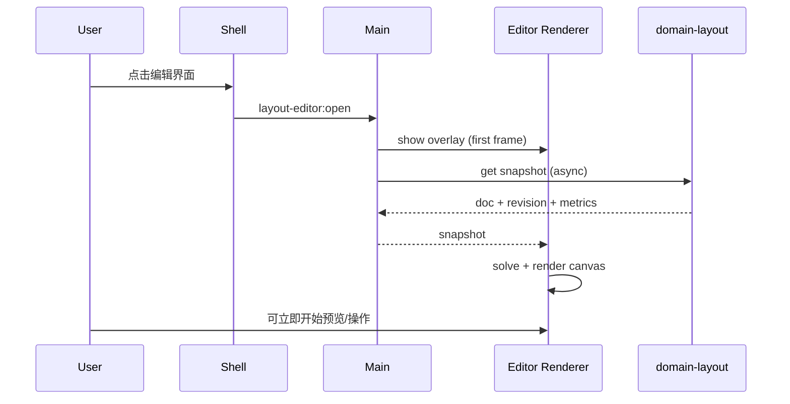

# 05 · 性能预算与优化台账

> 上位规范：[PART19 · 性能标准与优化手册](../../docs-new/11-性能标准与优化手册.md)。
> 本文只回答一件事：**浏览器界面叠加编辑和积木布局系统具体怎样满足这些门禁，怎样量化。**
> 与 PART19 冲突时，以 PART19 的 P0 / P1 / P2 分级为准。

## 1. 不可突破的门禁

| 指标 | 门禁 | 本系统检查点 |
| --- | --- | --- |
| 输入 → 第一帧可见反馈 | ≤ 16ms | pointerdown、点击构件、打开 / 关闭编辑器 |
| 操作可交互 | ≤ 100ms | 打开叠加编辑层、应用模板、拖入新列 |
| 渲染层单帧 | ≤ 16.7ms | 拖动、hover、尺寸预览、模板卡渲染 |
| 主进程单次同步块 | ≤ 8ms；>16ms 一票否决 | 文档读取、布局应用、原生 bounds、持久化调度 |
| 连续帧间隔 | P95 ≤ 20ms；最长帧 ≤ 50ms | 拖动与侧栏展开 |
| 闪烁 | 0 | 面板出现、折叠、栏位换边、模板应用 |
| 稳态抖动 | 0 | 窗口静置、面板加载完成后、resize 完成后 |
| IPC 单条 payload | ≤ 64KB | snapshot、catalog、command、event |
| 空闲 5 分钟内存漂移 | ≤ 5% | Studio 开关 20 次、Space 切换 10 次 |
| 动作增量内存 | 切 Space ≤ 60MB；普通编辑动作只创建零或一个视图 | Studio、模板应用、多面板展开 |

以上不是“优化目标”，是实施完成判据。

## 2. 架构上先消除性能债

### 2.1 几何单一来源

PART19 的 PERF-P0-05 / P0-10 / P2-10 / P2-11 要求在热路径中避免跨进程往返和布局读写交替。

布局系统采用：

```text
LayoutDocument + Environment + SurfaceMetrics
                    ↓
              LayoutEngine
                    ↓
    DOM plan / Native plan / DropZones
```

禁止：

- editor 自己复制一套 rail 宽度与面板间距算术；
- main 再写一套 `LayoutCoordinator` 专属的侧栏推导；
- drop 预览用一套算法，提交后真实布局用另一套；
- 拖动中逐帧向主进程询问 bounds。

### 2.2 求解缓存

新增有上限的 `LayoutResolutionCache`：

```ts
key = [
  document.id,
  document.revision,
  environment.width,
  environment.height,
  environment.context,
  environment.spaceId,
  metrics.signature,
  blockAvailability.signature
].join(':')
```

约束：

- 最多 4 份；
- 只缓存 `ResolvedLayout`，不缓存 DOM；
- 文档 revision / viewport / context / metrics 任一变化即失效；
- `clear()` 在 dispose 时调用；
- 不把模板全部预先求解成长期缓存。

### 2.3 文档与 catalog 分开传输

布局文档只引用稳定 `blockId`，不重复携带图标、标题、预览函数和插件描述。

- 文档正常目标 ≤ 32KB；
- 单条 snapshot 硬上限 64KB；
- 超限改用 `generation + sequence` 分片传输，单片 ≤ 48KB；
- catalog 按 family / page 分页，构件库展开到某分类时再拉；
- IPC 事件只发 `layoutId + revision + changedNodeIds`，不发整份文档。

## 3. 编辑器打开与关闭

### 3.1 打开

用户点击“打开布局工坊”后，动作帧只允许：

1. 显示当前界面上的编辑蒙层；
2. 请求 editor overlay 显示；
3. 安排 catalog / snapshot 的异步读取。

禁止：

- 同步读取 SQLite；
- 同步解析所有模板；
- 创建任何面板 renderer；
- 对全部 block 生成真实预览；
- 等待插件模块加载完成后才显示首帧。

打开流程：



`layout-editor:open` 的同步段目标 < 8ms。

### 3.2 关闭

- 点击完成 / Esc：先关闭交互与蒙层，动作帧不落盘；
- 下一拍 flush 未提交文本输入；
- 销毁 editor overlay renderer；
- 清 rAF、pointer capture、ResizeObserver、temporary nodes、layout resolution cache；
- 面板和网页视图不因 Studio 关闭而重建。

编辑浮层不是常驻后台层。关闭后不保留一个 0×0 的高成本 editor renderer。

## 4. 拖拽热路径

### 4.1 动作分段

| 阶段 | 允许 | 禁止 |
| --- | --- | --- |
| pointerdown | 记录起点、缓存 zones、设置 pointer capture | 读整棵 DOM、发 IPC、写库、改建面板 |
| pointermove | 更新 dx/dy、rAF 标记、写 ghost transform | `getBoundingClientRect()` 全扫、排序、模板求解、日志 stringify |
| rAF | 一次命中、一次插入线、一次状态比较 | 多次 DOM 读写交替、重复布局 |
| pointerup | 一次 command、一次本地求解、一次持久化调度 | 同步 SQLite、销毁多个视图 |
| commit | 真实 surface 更新、原生 bounds 同 tick 落位 | 先 visible 再等 IPC 上 bounds |

### 4.2 几何缓存

每次拖拽会话持有：

```ts
interface DragGeometryCache {
  zones: DropZone[]
  nodeRects: Map<string, Rect>
  scrollOffsets: Map<Element, number>
  viewport: { width: number; height: number }
}
```

- `pointerdown` 一次性生成；
- 不滚动、不 resize、不改变 catalog 时一直复用；
- 滚动或窗口 resize 时只标记 dirty，下一 rAF 重建；
- `pointerup` 后释放引用。

### 4.3 DOM 复用

编辑器节点按稳定 `node.id` 建立：

```ts
nodeRecords: Map<string, {
  key: string
  frame: HTMLElement
  block: HTMLElement
  lastState: string
}>
```

拖放后只做：

- 移动已有 DOM；
- 更新 `data-state`；
- 更新必要 transform；
- 增删真正变化的节点。

禁止每次节流事件都 `root.innerHTML = ''` 后重画。

### 4.4 `will-change`

- 只加给正在拖的 ghost、正在 resize 的列；
- 手势结束后立即移除；
- 不对所有构件卡和所有节点常驻。

## 5. 真实布局提交

### 5.1 同帧落位

一次 drop 提交必须把：

1. 节点显隐；
2. DOM chrome 的新位置；
3. 原生面板 / Web Sidebar 的新 bounds；
4. background throttling 状态；

放进同一个布局事务。不能在面板可见后才等下一次 IPC 拿 bounds。

### 5.2 原生写入去重

继续使用并强化现有机制：

- `_setBoundsIfChanged`；
- `_setRadiusIfChanged`；
- `setVisible` 先读真实原生状态；
- `addChildView` 先确认当前父级和层级；
- 面板组切换仅改可见集合和 bounds，不重复 add 同一 view。

每次提交记录：

```text
affectedNodes=N
boundsWrites=X
visibleWrites=Y
radiusWrites=Z
childAdds=A
```

目标：未变化项写入 0。

### 5.3 多面板加载

- 布局应用不等于面板打开；
- 组内浏览器只加载**当前激活面板**；
- 其他成员只有 catalog 描述，不创建 renderer；
- 用户切到另一成员才按现有冷启动路径创建；
- 布局拖动中不创建、不销毁面板；
- 面板组结构变化后，被移除的面板视图在下一拍按现有关闭即销毁策略回收。

## 6. resize 与折叠

### 6.1 窗口 resize

- `resize` 帧只求解轻量 geometry，并更新 ghost / outline；
- 真实面板和 Web Sidebar 只更新必要 bounds；
- 不在 `resize` 中重排复杂面板内容；
- 停止 resize 后 160ms 做一次完整布局修正；
- 连续 resize 期间不复用过期 metrics；每帧最多一次测量。

### 6.2 折叠 / 展开

- DOM 栏使用 transform / opacity / clip；
- 原生面板的展开与折叠只做一次 bounds 或 visible 批量事务；
- 展开一个面板时，不重建同列其他面板；
- 收起后背景节流恢复；
- 悬停唤出期间不启动高频定时器；继续使用现有主进程边缘监测。

## 7. 模板与预览性能

### 7.1 模板

- 模板缩略图用同一求解器生成微型 DOM / SVG；
- 一个模板缩略图目标 ≤ 1ms；
- 模板列表虚拟化或分页；
- 面板卡片与模板卡不加载真实 panel；
- 图片 / 插件缩略图声明宽高比，避免 CLS；
- 只给可视卡片设置 preview observer。

### 7.2 大布局

- 节点数超过 200 时，画布只挂载当前可见 frame 的 DOM；
- 深层容器按需展开；
- 检查器只渲染选中节点字段；
- 画布缩放不改变数据模型；
- 画布使用 CSS transform 缩放，不重算每个子元素的原始 px 样式 10 次。

### 7.3 预览刷新

- 拖动期间仅更新插入线与 ghost；
- 松手才更新全画布；
- 输入字段 80ms 合并；
- 模板预览在输入停止后再求解；
- 预览缓存带 revision + viewport + theme 的 key。

## 8. 持久化

### 8.1 用户动作帧

禁止在同一事件处理里：

- `writeFileSync`；
- SQLite 同步写；
- `JSON.stringify` 完整大文档；
- 压缩 / base64；
- 同步读所有模板。

### 8.2 写路径

```text
command applied
  → local preview
  → scheduleSave(160ms)
  → next tick main handler
  → validate
  → transaction update document + append revision
  → emit changed { ids }
```

- 文档 ≤ 64KB 时一次写；
- 更大时走分片提交或把超量 preview 数据与核心结构分开保存；
- 只有 dirty 时 flush；
- 退出前一次同步 flush，只写脏数据；
- SQLite 单次同步段目标 < 8ms。

### 8.3 revision

- revision 只在语义提交上创建，不给 pointermove 建记录；
- `layout_revisions` 上限 100；
- 保存时只做一次稳定序列化；
- 比较去重，内容相同不写。

## 9. IPC 与广播

### 9.1 分级

| 事件 | 最远范围 | 说明 |
| --- | --- | --- |
| editor mouse / drag | 无 IPC | 全在 editor renderer |
| runtime preview after drop | targeted | 只发给当前窗口 |
| layout:changed | window | 同一布局文档会影响同窗各 surface |
| theme / locale | 按现有全局规则 | 不因编辑器扩大 |
| plugin catalog changed | targeted / window | 由当前编辑器或 surface 需要决定 |

### 9.2 去重

- document id + revision 相同不发；
- changedNodeIds 为空不发；
- 同一 tick 多命令合并；
- 编辑器自己发起的变更可回传 origin，避免重复重建；
- 事件 payload 不含整份 document。

### 9.3 在途任务

每次打开叠加编辑层或切换 Space 都生成 `generation`：

- 异步 snapshot 回来时检查 generation；
- 旧模板加载结果不得写入新 Space；
- 关闭编辑器即 `AbortController.abort()` 或 generation++；
- 旧任务不得在后台继续构建模板 DOM。

## 10. 内存预算

| 对象 | 上限 | 释放 |
| --- | --- | --- |
| Editor overlay renderer | 1 / 窗口，仅编辑期间 | 关闭 Studio 立即销毁 |
| Layout resolution cache | 4 份 | revision / env 改变淘汰，dispose 清空 |
| Template preview cache | 32 个轻量结构结果 | LRU，关闭 Studio 清空 |
| Block thumbnail cache | 64 个，每项仅小 SVG / DOM 描述 | LRU |
| Drag geometry cache | 1 份 | pointerup / cancel 立即释放 |
| 用户模板列表 | 分页 | 页离开释放 |
| layout revisions | 100 / 文档 | 尾部删除 |
| catalog 缓存 | 仅当前编辑器快照 | 关闭释放 |

禁止：

- 预加载全部 panel renderer；
- 保存模板大截图；
- 将 DOM 节点长期存在文档状态；
- 在插件提供的预览对象中保留 webContents；
- 让已关闭叠加编辑层的 listener / timer / rAF 存活。

## 11. 作用域与正确性

叠加编辑层中的每个异步任务都必须带：

```ts
{
  generation: number
  profileId: string
  spaceId: string
  windowId: number
  layoutId: string
  baseRevision: number
}
```

以下操作必须幂等：

- 打开 / 关闭 Studio；
- 应用同一模板两次；
- 重复选中同一节点；
- 重复应用同一 layout revision；
- 关闭已关闭的面板组；
- 折叠已折叠的列。

切换 Space、关闭窗口、切回旧模板时，在途写入不得落到错误 scope。

## 12. 失败路径

每个编辑会话必须使用 `try/finally` 清：

- pointer capture；
- window event listener；
- rAF；
- ResizeObserver；
- 暂存 ghost / caret；
- 临时 template object URL；
- 未完成 IPC 的 request token。

失败时：

- 保留上一份已确认布局；
- 显示可恢复错误，而不是覆盖为空白；
- 文档校验失败时回退 revision；
- 面板视图创建失败时不拖垮其他布局；
- 插件 preview 抛错时显示普通 block 卡，不重试死循环。

重试规则：

- 最多 3 次；
- 指数退避；
- 新 generation 取消旧重试；
- 禁止 0ms 重试。

## 13. PART19 P0 对照

| PART19 条目 | 本方案对应 |
| --- | --- |
| P0-01 动作帧不落盘 | command 只改 draft；160ms 后异步落库 |
| P0-02 动作帧不批量销毁 | panel group 变动的成员回收延后一拍并复核 generation |
| P0-03 热路径无同步 IO / 无界计算 | pointermove 只记值；求解器 O(n) |
| P0-04 事件合批 | pointer / resize / inspector 输入按 rAF 或时间窗合批 |
| P0-05 不逐帧 IPC | drop 命中在 editor 本地；只在落定后发一条提交 |
| P0-06 结构调整同帧落位 | drop commit 合并 visible + bounds |
| P0-07 原生写去重 | 复用 `_setBoundsIfChanged`、`_setRadiusIfChanged`、原生可见性读取 |
| P0-08 DOM 复用 | nodeRecords 按稳定 id 更新，不整树重建 |
| P0-09 首帧稳定 | catalog / 编辑器能力先确定；不可用 block 不闪入闪出 |
| P0-10 布局读写分离 | pointerdown 一次性读；rAF 只写；提交后再测 |
| P0-11 休眠即销毁视图 | 面板收起按现有 WCM 生命周期回收 |
| P0-12 缓存有上限 | resolution / preview / thumbnail / geometry 全有 max + clear |
| P0-13 关闭即销毁 | editor overlay 关闭即销毁；不 keep-alive 全部面板 |
| P0-14 隐藏视图节流 | 复用 `_syncFloatThrottle`，编辑器停止后恢复 |
| P0-15 定时器可停 | 编辑器所有 timeout / rAF / observer 有 dispose |
| P0-16 订阅可回收 | EditorSession 持有 disposer 栈 |
| P0-17 异步钉作用域 | generation + profile / space / window 快照 |
| P0-18 状态幂等 | open / close / select / group toggle 全部去重 |
| P0-19 广播最小 | 编辑动作本地；提交只到目标窗口 |
| P0-20 同值不广播 | revision / changedIds / metrics signature 去重 |
| P0-21 启动不预热 | 打开浏览器不创建 editor；不加载全部模板和面板 |
| P0-22 常驻开销写释放点 | 本文 §10 |

## 14. 目标净账（实施时回填实测）

> 这里只列设计目标。代码落地后必须用实测值替换“目标”，并同步更新 PART19 §10。

| # | 路径 | 当前 / 传统做法 | 本方案目标 |
| --- | --- | --- | --- |
| 1 | 拖动 100 次节点 | 每次全量测量与持久化 | 持久化 0；本地 style 写每帧 ≤ 1 次 |
| 2 | 原生 bounds 应用 | 每个节点无脑写 | 只写变化项，通常 0–2 次 |
| 3 | Studio 开关 | 可能预热多个面板 / 模板图 | 面板 renderer 新增 0 |
| 4 | panel group 切换 | 重建所有成员 | 仅目标 panel 创建 / 激活 |
| 5 | 窗口 resize | 每帧完整重排 | 轻几何每帧；完整求解静置后 1 次 |
| 6 | 模板切换 | 截全页图 / 全量重建 | 结构缩略图；实际 surface 1 次事务 |
| 7 | 编辑器广播 | 全窗多次事件 | 每次语义提交 1 次 changed |
| 8 | 状态写盘 | 每 move 一行 | 每次无操作 0；每次语义提交最多 1 |

## 15. 手工性能验收

不做性能测试脚本堆砌，按 PART19 §13 的真实操作验证：

### 15.1 每次关键改动

1. 打开叠加编辑层，计时到可交互；
2. 拖动一个按钮 20 次，观察 ghost 是否贴手、插入线是否跟手；
3. 新建左右各一列，放两个面板组；
4. 折叠 / 展开 10 次，确认没有一帧空面板；
5. 打开面板后关闭，看任务管理器中 renderer 是否按时回落；
6. 关闭 Studio，静置 10 秒，DevTools 确认没有持续 rAF；
7. 重启应用，布局恢复。

### 15.2 性能深测

1. Performance 录制拖拽过程，帧间隔 P95 ≤ 20ms；
2. Long Task observer 下拖动、模板切换、resize 无 >50ms 长任务；
3. 记录应用前后 renderer 数量与 RSS；
4. 空闲 5 分钟后 RSS 漂移 ≤ 5%；
5. 快慢窗口切换与 Space 切换时，异步任务没有写错 scope。

任何 P0 失败都先回滚布局提交，不做“带着闪烁继续开发”。

## 16. 性能红线（本项目专属）

- 拖动中移动真实 `WebContentsView`：禁止。
- pointermove 中发 IPC：禁止。
- 每次拖放重建整个画布：禁止。
- 模板缩略图截图真实面板 / 网页：禁止。
- 以真实 panel renderer 作为拖拽预览：禁止。
- 打开叠加编辑层即创建全部 panel：禁止。
- 每次命令写完整 revision：禁止。
- 使用文件监听轮询布局目录：禁止。
- 用 `setInterval` 刷新 preview：禁止。
- 让 preview cache 永不过期：禁止。
- 用一个全局 `JSON.stringify` 对每个 pointermove 做 diff：禁止。
- 让原生 WCO 按钮参与普通 DOM 动画：禁止。

## 17. 拖放跟手优化落地台账

本轮针对“松手后同步重排造成一顿”的路径完成以下改造。

| 路径 | 改造前 | 改造后 | 净账 |
| --- | --- | --- | --- |
| pointerup 到编辑层落位 | 同步清空并重建全部 zone / chip DOM | 只提交本地状态，渲染排到下一 rAF | 输入处理中的全量 DOM 重建 1 → 0 次 |
| 编辑层持久化 | pointerup 调用链上直接发设置 IPC | 下一拍执行，同栏位连续提交只保留最后一组状态 | 同拍设置提交最多 1 批/栏位 |
| 外壳布局施加 | 每个 `settings:changed` 都执行一次 `apply()` | rAF 内合并布局键后只施加 1 次 | 单次拖放重排 N → 1 次 |
| 几何重测 | 每次脚本请求立即广播 | 12ms 窗口合并，施加后补报一次 | 同拍 remeasure N → 1 次 |
| ghost 跟手 | 每帧写 `left/top` | 只写 `transform: translate3d(...)` | 每帧布局写 0 次；合成层位移 1 次 |
| 插入线与投放框 | 每帧删除并重建元素 | 拖拽开始创建一次，移动时只改样式/显隐 | 元素创建 O(frame) → O(drag) |
| 截图缓存 | 任意布局 state 变化都隐藏编辑层重抓 | 仅紧凑模式或横竖方位改变时重抓 | 普通顶↔底、左↔右、按钮换序截图 0 次 |
| 无关设置写入 | 每次落位重写全部区域键 | 只写实际变化的区域、行序、侧序与模式 | 常规重排写盘 IPC 约 6–8 → 1–3 次 |

截图刷新仍保留旧图，直到确实需要重抓的那一拍才置空引用；旧 data URL 不再被下一次普通重排继续持有。连续快速拖放期间，界面状态先由本地乐观更新承接，持久化队列按栏位串行处理，避免旧提交反向覆盖新落位。
