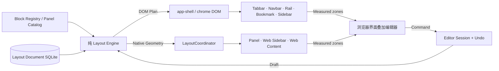

# Hira NG 编辑模式重构 · 叠加式积木布局

> 目标：把现有「编辑按钮」升级为浏览器界面上的叠加编辑器。真实浏览器始终是主体；用户直接在 navbar、标签栏、工具 rail、侧栏、面板、独立网页侧栏和自定义栏位上拖放。模板、构件库与检查器从顶部中央的「更多按钮」面板展开，不把整窗替换成后台式编辑器。

## 1. 最终结论

现有代码不需要推倒重来。它已经具备三块很难重新建立的基础：

1. **跨 WebContentsView 的编辑几何链**：外壳 / rail 隐身，编辑浮层按窗口坐标克隆真实按钮，拖拽全部发生在同一个 renderer 内。
2. **纯函数布局计划**：`packages/shared-types/src/layout.mjs` 已经把 block、region、axis 分层，并由 `ui-chrome-layout` 施加。
3. **运行时目录与插件贡献链**：面板、导航按钮、rail 图标都来自同一份运行时 catalog，插件启停能全链路生效。

真正要做的是把这三块收口成一套统一的 **Layout Document + Block Registry + Layout Engine + Editor Session**，而不是继续往 `app.*_buttons`、`app.*_position`、`app.*_width` 上追加更多设置键。

## 2. 六个硬决策

| 决策 | 结论 |
| --- | --- |
| 自由度边界 | 不做浏览器 chrome 的任意绝对坐标画布。采用可嵌套的横向 / 纵向容器、四边 dock、标签组、浮层和折叠形态；任何拖放最终都归一化为结构操作，保证响应式与主进程几何可计算。 |
| 显示与存储 | 一个布局文档是唯一真源。按钮顺序、显隐、栏位、面板组、宽度、折叠、模板和项目级变体都写在文档里，不再各存一条设置。 |
| 编辑体验 | 默认直接在真实浏览器界面上叠加编辑；中央工具条和居中的更多按钮面板只提供局部工具。拖拽期间不推动真实原生视图，drop / inspector commit 后才更新底板。 |
| 主进程边界 | `LayoutEngine` 是跨进程纯 TypeScript 模块。renderer 用它排 DOM，主进程用它排 `WebContentsView`，禁止两边各算一遍。 |
| 插件边界 | 面板继续来自现有 `PanelCatalog`；插件可声明新的 block、template、inspector schema 和预览 renderer。编辑核心只认识描述符与稳定 key。 |
| 安全恢复 | 必须提供 Safe Layout：核心命令入口、全局快捷键、最后一份可恢复 revision。用户把栏位藏光了，也永远有路径回来。 |
| 性能门禁 | 严格遵循 `docs-new/11-性能标准与优化手册.md`：动作帧只上屏，重活延后；几何单一来源；不逐帧 IPC；复用 DOM；原生写入去重并在同帧落位。 |

## 3. 文档导航

| 文档 | 用途 |
| --- | --- |
| [01-现状与 Shift 对照](./01-现状与Shift对照.md) | 项目真实现状、已有资产、缺口、Shift Builder 可学与不可直接照搬的部分 |
| [02-积木布局架构与数据契约](./02-积木布局架构与数据契约.md) | 统一模型、求解器、包边界、SQLite、IPC、插件扩展点、迁移策略 |
| [03-编辑器交互与视觉规范](./03-编辑器交互与视觉规范.md) | 两种编辑入口、拖放、预览、特殊布局开关、面板组、响应式、视觉与流畅度 |
| [04-实施顺序与落地清单](./04-实施顺序与落地清单.md) | 从垂直切片到全量替换的实施顺序、文件清单、删旧代码、回滚与会话交接 |
| [05-性能预算与优化台账](./05-性能预算与优化台账.md) | 以 PART19 为上位规范，约束帧预算、拖拽、原生写、IPC、内存和持久化 |

## 4. 目标形态

## 5. 第一版必须完整覆盖

- 导航栏、标签栏、rail、侧栏、书签栏、标题栏中的可编辑按钮。
- `Bars` 中的标签栏、navbar、书签栏、rail 以完整真实比例样例整条拖动；内部按钮不属于整栏拖动单位。
- 栏位四向落位必须映射到既有布局模式：标签栏到侧边为 Edge 型垂直标签，navbar 同侧为全功能侧栏，rail 四向落位对应 `app.sidebar_position`。
- 按钮排序、显隐、固定、分组、移入抽屉 / 溢出区。
- 四条边上的栏位布局，栏位合并、堆叠、紧凑、折叠和自动隐藏。
- 左右两侧新增自定义列；列内放面板组、工具组、书签 / 快捷项、间隔和分隔线。
- 面板的左右停靠、双列并存、标签组、折叠、固定和多面板组合。
- 全局布局、按 Space 布局、窗口宽度响应规则、专注 / 分屏 / 沉浸模式覆盖。
- 模板、结构缩略图、组件图文卡、布局导入导出、撤销重做、恢复默认。
- 插件启停后的 block 可用性变化；插件回来时原位置和配置恢复。
- 编辑期间真实浏览器界面始终可见；工具条位于顶部中央，“更多按钮”面板也在中央展开。
- 拖拽、打开叠加层、模板应用和持久化满足 PART19 的单帧、闪烁、内存与波及门禁。

## 6. 明确不做

- 不做紫色渐变、玻璃拟态、固定三等分营销卡片。
- 不把整个浏览器界面替换成全屏后台式编辑器，不设置永久左右栏。
- 不把 DOM 预览覆盖到网页上；所有覆盖网页的可视元素继续由原生浮层承载。
- 不让 renderer 直接操作 SQLite，也不允许 UI 直接依赖 `infra-db`。
- 不允许每个界面复制一份「自己的顺序表」；所有顺序必须落在同一布局文档。
- 不把窗口原生 WCO 按钮伪装成可搬动组件。系统按钮的物理限制如实呈现；自绘模式才开放移动。
- 不为单一面板、单一模式写新的散落 `if (id === ...)`；差异必须进入 Block Definition 或 Variant。

## 7. 命名

- 产品名称：**界面编辑 / Layout Overlay**。
- 入口：菜单与命令均直接进入叠加模式。
- 文档格式：`.hira-layout.json`。
- 根布局文档：`LayoutDocument`。
- 可拖构件：`LayoutBlock`。
- 布局容器：`LayoutFrame`。
- 编辑器会话：`LayoutEditorSession`。

